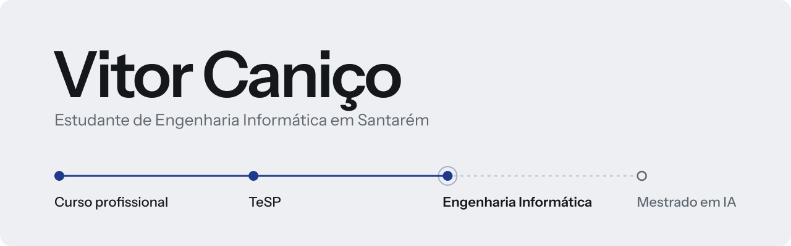

<picture>
  <source media="(prefers-color-scheme: dark)" srcset="https://raw.githubusercontent.com/Canicoop/Canicoop/main/assets/banner-escuro.svg">
  
</picture>

### Olá, sou o Vitor.

Quando quase toda a gente foi para Ciências no 10.º ano, eu escolhi um curso profissional de informática, porque já sabia que queria programar. Depois fiz um TeSP, com estágio full-stack na Londublis, para ganhar mais experiência. Agora estou a terminar Engenharia Informática, um sonho antigo. O próximo passo é começar a trabalhar na área e, ao mesmo tempo, aprofundar-me num mestrado em Inteligência Artificial.

Sou social, animado e dedicado, e quero continuar a crescer como pessoa e como programador.

#### Ferramentas do dia a dia

#### LevelUp

A app que uso todos os dias para gerir o treino, o peso e as finanças. É uma web app pensada para o telemóvel, instalável no iPhone pelo Safari, feita com React, TypeScript e Supabase.

- Treino registado série a série, com o último peso e as repetições sempre à vista
- Peso diário com gráfico de evolução e média móvel de 7 dias
- Finanças, em desenvolvimento

[Experimenta a app](https://levelup-canico.vercel.app) ou [vê o código](https://github.com/Canicoop/levelup).

#### Agora

<!-- agora:inicio -->
A atualizar…
<!-- agora:fim -->

[LinkedIn](https://www.linkedin.com/in/vitor-cani%C3%A7o/)
